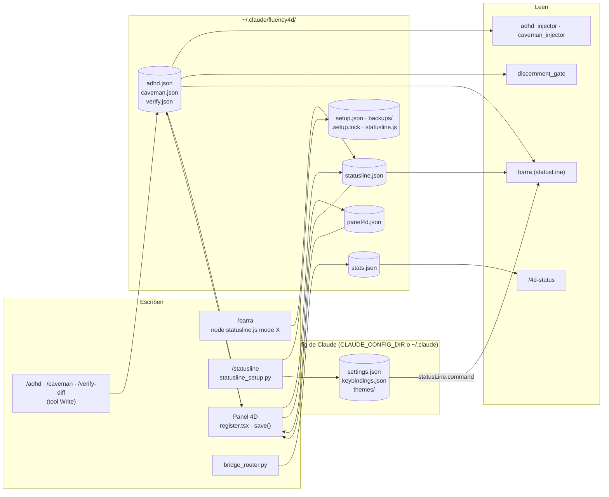

# fluency-4d — guía de arquitectura para desarrolladores

Cómo está armado el plugin por dentro: qué corre dónde, qué estado deja en disco, cómo se
hablan las piezas y qué tocar para extenderlo. Para *usar* el plugin, leé
[`fluency-4d.md`](fluency-4d.md); para *por qué existe*, [`filosofia.md`](../.claude/docs/filosofia.md).

> **Convención de referencias.** Las rutas `archivo:línea` son relativas a
> `plugins/fluency-4d/` salvo que empiecen con `tests/`, `tools/`, `scripts/` o `docs/`
> (raíz del repo). Las líneas corresponden al árbol de la rama `docs/fluency-4d-codigo`
> (fluency-4d 0.22.1, con los comentarios de código); al lado va siempre el símbolo
> (`load_caveman`, `cmd_setup`...) para ubicarlo aunque el archivo se mueva. Si una línea
> no coincide, buscá el símbolo.

Esta guía **no repite** lo que ya está documentado; enlaza:

| Tema | Dónde vive |
|------|------------|
| Contratos de stdin/stdout, guardas obligatorias, trampas de hooks | [`.claude/docs/hooks.md`](../.claude/docs/hooks.md) |
| Anatomía de skills, registro doble, contrato de `fluency_check_skills.py` | [`.claude/docs/skills.md`](../.claude/docs/skills.md) |
| Cómo correr pytest / `node --test` / `claude plugin test`, aislamiento, lock y variables de test del setup | [`.claude/docs/testing.md`](../.claude/docs/testing.md) |
| Versionado, caché del plugin, CI | [`.claude/docs/release.md`](../.claude/docs/release.md) |
| Ruff, ASCII, PEP-723, estilo | [`.claude/docs/convenciones.md`](../.claude/docs/convenciones.md) |
| Ciclo de vida de `estado-sesion.md`, `lecciones.md`, puentes | [`.claude/docs/persistencia.md`](../.claude/docs/persistencia.md) |

---

## 1. Mapa del plugin

```
plugins/fluency-4d/
├── .claude-plugin/plugin.json   manifest: versión, "types", lista de skills (registro doble)
├── .claude-plugin/types/        tipos del engine de mods (gitignored, los escribe Claude Code)
├── CLAUDE.md                    instrucciones que el plugin le da a Claude en cada sesión
├── hooks/
│   ├── hooks.json               registro de eventos (hooks Python) + "modules" (panel)
│   ├── hook_utils.py            utilidades compartidas: I/O, estado por sesión, flags, escritura atómica
│   ├── bridge_router.py         UserPromptSubmit
│   ├── plan_calibrator.py       UserPromptSubmit
│   ├── caveman_injector.py      UserPromptSubmit
│   ├── adhd_injector.py         UserPromptSubmit
│   ├── suite_playbook.py        UserPromptSubmit
│   ├── doc_drift.py             PostToolUse (Edit|Write|MultiEdit|NotebookEdit)
│   ├── memory_checkpoint.py     PostToolUse (.*)
│   ├── discernment_gate.py      Stop
│   ├── statusline_setup.py      NO es un hook: lo invoca la skill /statusline
│   └── register.tsx             hooks module del engine de mods: Panel 4D (/panel)
├── statusline/statusline.js     la barra de estado (Node) + subcomando `mode`
├── statusline/test/*.test.js    tests `node --test` de la barra
├── skills/<nombre>/SKILL.md     10 skills (ver plugin.json:23-34)
├── themes/templado.json         tema custom de Claude Code
├── types/index.d.ts             contrato de $.state del panel (SE COMMITEA)
├── tests/panel.test.tsx         tests del panel (`claude plugin test`)
└── tsconfig.json                extiende .claude-plugin/types/tsconfig.json
```

### Qué corre en qué runtime

| Pieza | Runtime | Quién la lanza |
|-------|---------|----------------|
| `hooks/*.py` (los 8 hooks) | Python ≥ 3.11 vía `uv run --script` (PEP-723, sin dependencias) | Claude Code, por evento (`hooks/hooks.json:10,21,...`) |
| `hooks/statusline_setup.py` | Python vía `uv run --script` | la skill `/statusline` (`skills/statusline/SKILL.md:5,17`) |
| `statusline/statusline.js` | Node (el setup exige ≥ 18, `statusline_setup.py:114` `MIN_NODE_MAJOR`) | Claude Code como `statusLine` (la **copia fija** `~/.claude/fluency4d/statusline.js`), y la skill `/barra` con `mode <opción>` |
| `hooks/register.tsx` | engine de mods de Claude Code (TSX, API `$`) | Claude Code, declarado en `hooks/hooks.json:98` `"modules": ["./register.tsx"]` |
| `skills/*/SKILL.md` | ninguno: instruyen a Claude | el usuario (`/nombre`) o los triggers |

Los hooks Python importan `hook_utils` por ruta (`sys.path.insert(0, Path(__file__).parent)`,
p. ej. `bridge_router.py:46`); `suite_playbook.py:41` además reusa `normalize`/`keyword_matches`
de `bridge_router`.

### Exclusivo de Claude Code

`tools/multiharness/build_harness.py:59-69` (`CLAUDE_CODE_ONLY`) lista lo que **no** se emite
a los bundles de Codex/OpenCode: `hooks/register.tsx`, `tests`, `types`, `tsconfig.json`,
`.claude-plugin/types`, `statusline`, `themes`, `skills/barra` y `skills/statusline`.
Además `CLAUDE_CODE_ONLY_HOOK_KEYS = ("modules",)` (`build_harness.py:72`) quita la clave
`modules` de `hooks.json` antes de transpilar. Todo lo demás (los 8 hooks Python y el resto de
las skills) es multiharness: si agregás algo que dependa de la barra o del engine de mods,
sumalo a esa tupla (lo verifica `tests/scripts/test_build_harness.py`).

---

## 2. Eventos y hooks

Registro: `hooks/hooks.json`. Todos los hooks Python tienen `timeout: 5` y un
`statusMessage`. Los cinco de `UserPromptSubmit` son grupos separados con `matcher: ".*"`
(`hooks.json:3-59`); **no dependen del orden entre ellos**: la precedencia ADHD/Caveman se
resuelve leyendo los flags, no por orden de ejecución.

Todos comparten el esqueleto de `hook_utils.py`: `read_stdin_safe` (`:129`, hilo + join, sirve
en Windows) → `parse_hook_input` (`:150`) → guarda `agent_type` (no actuar en subagentes) →
lógica → `output_context` / `output_stop_block` / `output_empty` (`:169-180`). El decorador
`hook_main` (`:211`) convierte cualquier excepción en pass-through. Contratos de salida y
trampas: [`hooks.md`](../.claude/docs/hooks.md).

| Hook | Evento (`hooks.json`) | Qué hace | Estado que usa |
|------|----------------------|----------|----------------|
| `bridge_router.py` | `UserPromptSubmit` (`:4-14`) | Primer prompt: si existen `.claude/docs/lecciones.md` / `estado-sesion.md` del proyecto, pide leerlos (con la edad del estado; > 24 h = "verificá vigencia") (`arranque_lines`, `:111-146`). Cada prompt: matchea keywords de `.claude/docs/bridges.json` (casefold, sin acentos, lookarounds, `keyword_matches` `:87`) e inyecta "LEÉ `<archivo>`"; máx. 2 temas por prompt (`MAX_TEMAS_POR_PROMPT`, `:63`) + 1 sugerencia de tema relacionado (`:225-259`). Campos de `bridges.json` pasan por `sanitize_field` / `safe_doc_path` (`hook_utils.py:73,100`). Emisión única al final (`:292-305`) | temp `-bridge`; `stats.json` vía `bump_stats` (`:300`) |
| `plan_calibrator.py` | `UserPromptSubmit` (`:15-25`) | Edge-trigger: solo en la transición `permission_mode` no-plan → `plan` (`:83`) inyecta `PROTOCOLO` (`:51`): tarea grande → advisor → plan → critic; chica → plan liviano | temp `-calib` (`last_mode`) |
| `caveman_injector.py` | `UserPromptSubmit` (`:26-36`) | Si `load_caveman()` devuelve el flag, reinyecta `DIRECTIVA[level]` (`:52`) **en cada turno** (sin edge-trigger: eso es la persistencia) | lee `caveman.json` |
| `adhd_injector.py` | `UserPromptSubmit` (`:37-47`) | Igual que caveman con `DIRECTIVA` (`:58`), pero cede si caveman está activo (`:95`) | lee `adhd.json`, `caveman.json` |
| `suite_playbook.py` | `UserPromptSubmit` (`:48-58`) | Con frases estrechas (`CLUSTERS`, `:58`) inyecta un nudge para que Claude *ofrezca* indexar o auditar; una vez por tipo por sesión; nunca en plan mode (`:94`) | temp `-playbook` (`nudges_dados`) |
| `doc_drift.py` | `PostToolUse` `Edit\|Write\|MultiEdit\|NotebookEdit` (`:61-71`) | Si el archivo editado cae bajo las `rutas` de un tema de `bridges.json` (matching por segmento, `prefix_matches` `:52`), recuerda revisar el doc del tema. Ignora ediciones bajo `.claude/` (`:93`); una vez por tema por sesión | temp `-drift` (`temas_avisados`) |
| `memory_checkpoint.py` | `PostToolUse` `.*` (`:72-82`) | Pide guardar `estado-sesion.md` y consolidar lecciones. Modo nativo: cruza `FLUENCY_4D_SAVE_PCT` (default 50, `:68`) y se re-arma con una caída > 20 puntos (`NATIVE_DROP_POINTS`, `:70`). Fallback por tamaño del transcript (bytes/4): cada `FLUENCY_4D_CHECKPOINT_EVERY_TOKENS` (default 120k, `:69`). Se saltea en plan mode sin tocar estado (`:173`) y si el proyecto no tiene `.claude/` (`:177`) | temp `-ckpt` |
| `discernment_gate.py` | `Stop` (`:84-96`) | Solo con `FLUENCY_4D_STRICT=1` **o** `verify.json` ON (`:65`): bloquea una vez por sesión con `CHECKLIST` (`:43`) vía `output_stop_block`. Respeta `stop_hook_active` (`:70`) | temp `-gate`; lee `verify.json` |
| Panel 4D (`register.tsx`) | `"modules"` (`:98`): eventos del engine `session.start`, `command.run`, `ui.close`, `ui.focus`, `ui.render`, `turn.step`, `turn.complete` | Ver [sección 5](#5-panel-4d-registertsx) | atoms + `~/.claude/fluency4d/*.json` |

---

## 3. Estado en disco

Regla del repo: los hooks **nunca** escriben dentro del proyecto del usuario; solo temp y
`~/.claude/fluency4d/`. Los archivos `.claude/docs/*` del proyecto los escribe *Claude* cuando
un hook se lo pide, no el hook.

`~/.claude/fluency4d/` se resuelve **siempre** desde el home, aun con `CLAUDE_CONFIG_DIR`:
`Path.home()` en Python (`hook_utils.py:319`, `statusline_setup.py:139` `fluency_dir`),
`os.homedir()` en la barra (`statusline.js:37`) y `homeDir`/`flagPath` en el panel
(`register.tsx:599-612`, que deduce Windows por `OS=Windows_NT`).

### Tabla de archivos

| Archivo | Formato | Default si falta o es inválido | Escribe | Lee |
|---------|---------|-------------------------------|---------|-----|
| `adhd.json` | `{"on": bool, "level": "auto"\|"lite"\|"full"}` | apagado | skill `/adhd` (tool Write, `skills/adhd/SKILL.md:24-35`; al prender, apaga `caveman.json`); panel `setMode` (`register.tsx:692`) | `hook_utils.load_adhd` (`:352`) → `adhd_injector`; barra `readFlag`/`fluencyModes` (`statusline.js:291-313`); panel `loadSnapshot` (`register.tsx:826`) |
| `caveman.json` | `{"on": bool, "level": "auto"\|"lite"\|"full"\|"ultra"}` | apagado | skill `/caveman` (Write; al prender apaga `adhd.json`); panel `setMode` | `load_caveman` (`hook_utils.py:311`) → `caveman_injector`, `adhd_injector`; barra; panel |
| `verify.json` | `{"on": bool}` (sin `level`) | apagado | skill `/verify-diff` (Write, `skills/verify-diff/SKILL.md:24-36`); panel `setMode` | `load_verify` (`hook_utils.py:333`) → `discernment_gate`; barra; panel |
| `statusline.json` | `{"mode": "simple"\|"normal"\|"experto", "theme": <tema>, "quiet": bool, "cutFraction": 0<f<1}` (claves ajenas se preservan) | `mode` = `STATUSLINE_MODE` o `experto` (`statusline.js:177-180`); `theme` = `STATUSLINE_THEME` o `templado` (`:88`); `quiet` = `true` salvo `false` explícito (`:482`); `cutFraction` = 0.5 (`:183-186`) | `statusline.js mode <x>` (`:615-638`, vía `/barra`; `atomicWriteJson` tmp + rename con reintentos, `:315-350`); panel `save` → `mergeJson` (`register.tsx:1069-1080`) | barra (una vez por proceso, `STATE`, `:86`); panel `loadSnapshot` (mismos defaults, `register.tsx:716-720`) |
| `panel4d.json` | `{"notify": bool, "cacheTtlMin": 5\|60}` | `notify: true`, `cacheTtlMin: 5` (`register.tsx:553,706-712`) | panel `save` (`:1099-1110`) | panel `loadPrefs` (`:706`) |
| `stats.json` | `{"<cwd resuelto, casefold>": {"sesiones": n, "temas": {"<tema>": {"inyecciones": n, "ultima": "AAAA-MM-DD"}}, "_ts": epoch, "ultima_actividad": "AAAA-MM-DD"}}`; poda proyectos con > 90 días sin actividad | `{}` | `bump_stats` (`hook_utils.py:374`, best-effort, sin lock) desde `bridge_router` | skill `/4d-status` (`skills/4d-status/SKILL.md:30`) |
| `statusline.js` (copia fija) | copia byte a byte del script del plugin | — (sin ella `/barra` falla con `Cannot find module`) | `statusline_setup.py setup` (`copy_atomic`) | Claude Code (`statusLine.command`); `/barra` |
| `setup.json` | registro transaccional del setup (ver [sección 6](#6-statusline-setupremovestatus)) | sin archivo = no instalado | solo `statusline_setup.py` (`save_record`, `:667`) | `statusline_setup.py` (`load_record`, `:653`) |
| `backups/` | `<archivo>.<AAAAMMDD-HHMMSS-ffffff>.bak` (quedan 3, `MAX_BACKUPS`), `<archivo>.orig.bak`, `<archivo>.orig.<ts>.bak` | — | `backup` / `ensure_orig_backup` / `stash_foreign_orig` (`statusline_setup.py:370-409`) | solo humanos (restauración manual) |
| `.setup.lock` | texto `"<pid> <uuid hex>"`, creado con `O_CREAT\|O_EXCL` | — | `setup_lock` (`statusline_setup.py:429`) | `setup_lock` |

Fuera de `fluency4d/`, estado efímero por sesión:
`<tempdir>/fluency4d/<session_key>-<sufijo>.json` (`hook_utils.py:241-297`), con sufijos
`-bridge`, `-calib`, `-playbook`, `-ckpt`, `-drift`, `-gate`; clave `sid-<sha256[:16]>` (o
`cwd-<hash>` sin `session_id`), TTL 4 h (`STATE_TTL_SECONDS`, `:52`), escritura atómica
(`save_state`, `:461`). Detalle en [`hooks.md`](../.claude/docs/hooks.md).

Los tres flags usan la **misma** regla de validación en hooks, barra y panel: objeto JSON,
`on === true` (un `"true"` string no cuenta) y, para adhd/caveman, `level` dentro del set;
ver [sección 4](#paridad-de-flags-con-hook_utils).

### Flujo



---

## 4. Status line (`statusline/statusline.js`)

### Ciclo de render

1. Claude Code ejecuta el `statusLine` configurado por el setup:
   `{"type": "command", "command": "node <copia fija>", "refreshInterval": 5}`, con la ruta citada por `shlex.quote` (comillas simples solo si hace falta)
   (`statusline_setup.py:915-919`). Corre con cada mensaje y además cada
   `refreshInterval` = 5 s (`REFRESH_INTERVAL_S`, `:98`; el comentario de `:94-97` explica
   el compromiso: un proceso Node cada 5 s). Si el usuario cambió el valor, el setup no lo pisa
   (`:934-942`). Según la [documentación de la status line](https://code.claude.com/docs/en/statusline),
   `refreshInterval` tiene mínimo `1`, las actualizaciones tienen un debounce de 300 ms y, si
   llega una nueva mientras el script sigue corriendo, Claude Code cancela el script en curso.
2. Al cargar, el script lee `statusline.json` **una vez** (`STATE`, `statusline.js:86`) y fija
   el tema (`THEME`, `:88`: archivo > `STATUSLINE_THEME` > `templado`).
3. Lee el JSON de sesión por stdin (UTF-8 por stream, `:658-661`). Si stdin no cierra en 2 s
   pinta igual (`STDIN_TIMEOUT_MS`, `:654-655`). `render` (`:647`) tolera JSON inválido (`{}`).
4. `collect` (`:382`) normaliza todo **una vez**: modelo, esfuerzo, ventana (`context_window_size`
   o 1M/200k por el id del modelo), tokens usados (`current_usage`, o el último turno del
   transcript, `contextFromTranscript` `:189`), límites 5h/7d, caché (`prompt_cache`), costo,
   rama git (`gitBranch` `:250`, sin seguir `gitdir` UNC) y los modos 4D (`fluencyModes`).
   Todo texto pasa por `clean` (sin caracteres de control).
5. Despacha por modo: `RENDER[readMode(STATE)]` (`:610,652`) → `renderSimple` (`:501`),
   `renderNormal` (`:521`) o `renderExpert` (`:554`). El consejo sale de `advice` (`:445`) y
   solo se muestra sin silencio (`QUIET`, `:482`).

"Charla larga" en la barra = `used >= cut`, con `cut = STATUSLINE_CUT_TOKENS` o
`round(windowSize * cutFraction)` (`:413`).

### Temas

`THEMES` (`statusline.js:66-75`): `tokyo-night`, `catppuccin`, `nord`, `gruvbox` y
`templado`; cada uno es un mapa de roles (`dim`, `label`, `text`, `model`, `accent`, `git`,
`ok`, `warn`, `bad`, y opcionales `rule`, `dot`) a hex truecolor. `isTheme` (`:82`) usa
`Object.hasOwn` para que `__proto__`/`toString` no cuenten como tema. `templado` es la versión
de barra de `themes/templado.json` (tema custom de Claude Code, se elige con `/theme`).

### Paridad de flags con `hook_utils`

La barra muestra un modo **solo si el hook lo aplicaría** (`statusline.js:274-313`). Los casos
viven en un fixture compartido, `tests/fluency-4d/fixtures/flags_parity.json`, que leen:

- `tests/fluency-4d/hooks/test_flags_parity.py` — corre los injectores reales y `load_verify`;
- `statusline/test/parity.test.js` — corre la barra en modo `experto` y `normal` y compara el
  segmento `4D ...`;
- `tests/fluency-4d/test_panel_contract.py` — verifica que `FLAG_CASES` de
  `tests/panel.test.tsx:1129` (el fs de esos tests es falso y no puede leer el fixture) sea
  copia de los casos adhd/caveman del fixture, con el valor de fila esperado en el panel.

Si cambiás una regla de flags, cambiala en los **tres** lugares (`hook_utils`, `fluencyModes`,
`modeValue`/`loadSnapshot` del panel) y agregá el caso al fixture.

---

## 5. Panel 4D (`register.tsx`)

### Estado: atoms

Tres atoms de `$.state` (`register.tsx:562-566`), tipados en `types/index.d.ts:44-52`:

| Atom | Tipo | Qué guarda |
|------|------|-----------|
| `live` | `Panel4dLive` | lo que se sabe de la sesión: modelo, esfuerzo, fast, tokens, ventana, %, plan 5h, `lastTurnAt`, auto-compact |
| `prefs` | `Panel4dPrefs` | espejo de `panel4d.json` (`notify`, `cacheTtlMin`) |
| `ui` | `Panel4dUi` | pestaña, `draft`, `current`, opciones de tema, `confirm`, `focus`, `busy`, `closing`, `note` |

### Borrador vs. valores reales

- `current` = valores **reales** leídos al abrir y después de guardar (`loadSnapshot`,
  `:826-885`: los `.json` de `fluency4d/`, `live`, `prefs`, `/config` y los temas custom de
  `<config>/themes/`, `customThemes` `:625`).
- `draft` = solo lo que **difiere** de `current`. `withValue` (`:925`) borra la entrada si el
  valor vuelve a ser el real; `pendingIds` (`:906`) son las claves pendientes.
- ADHD oculto por caveman: `current['mode.adhd']` vale `off` (como el hook), pero el nivel real
  queda en `mode.adhd.hidden` y `baseOf` (`:896`) lo usa si el borrador apaga caveman.
- `exclusive` (`:933`) mantiene ADHD/Caveman excluyentes también en el borrador; los perfiles
  (`loadProfile`, `:953`) solo cargan valores en el borrador.
- Nada se escribe hasta Guardar (`save`, `:1032`), que aplica en este orden: un parche a
  `statusline.json`; los modos (primero los que se apagan); `verify`; `panel4d.json`;
  `/config theme`; y `/effort`, `/model`, `/fast`, `/autocompact` vía `$.command.run`
  (`:1069-1136`). Lo que falla **queda en el borrador** (`finally`, `:1149-1163`).
- Cada escritura de archivo pasa por `mergeJson` (`:676`): cola por archivo (`serialized`,
  `:582`), `readStrict` (un JSON roto **tira** en vez de pisarse, `:651`), escribe, relee y
  verifica cada clave.

### Ciclo del mod

| Evento | Línea | Qué hace |
|--------|-------|----------|
| `session.start` | `:1228` | Registra el comando `panel` (`$.command.register`), carga `prefs` y arranca un `$.clock.every(30_000)` para el aviso de caché por vencer |
| `command.run` `{command: 'panel'}` | `:1264` | Resuelve la pestaña pedida (`tabOf`), refresca `prefs`, uso y settings, toma el snapshot; si el pane no estaba abierto el borrador arranca vacío (`DEFAULT_UI`); abre con `$.ui.open(OPEN)` |
| `ui.close` `{id: PANE}` | `:1293-1337` | Ver abajo: la única confirmación |
| `ui.focus` | `:1341` | Guarda el elemento con foco para la ayuda contextual |
| `ui.render` `{component: 'Pane'}` | `:1352` | Dibuja pestañas, filas, acciones y pie con la paleta del tema de la barra (`paletteOf`, `:478`); los handlers corren sueltos (`fire`, `:1368`) |
| `turn.step` | `:1857` | Actualiza modelo y esfuerzo del hilo principal |
| `turn.complete` | `:1871` | Solo hilo principal: marca `lastTurnAt`, refresca uso, toast de plan 5h ≥ 90 % (una vez por reset), y si el pane está abierto refresca `current` **sin tocar el borrador**; descarta la foto si hubo un guardado en el medio (`saveSeq`) |

**La única confirmación al cerrar.** Con cambios pendientes, "Salir" (`exitPane`, `:1185`) o Esc
(`ui.close` con `origin.kind === 'person'`) no cierran: ponen `confirm: 'exit'` y mueven el foco
a "Volver" (`:1188-1192`, `:1303-1311`). En esa fila (`:1705-1722`) "Volver" cierra la pregunta y
"Descartar y salir" llama a `closePane` (`:1168`), que vacía el borrador y marca `closing: true`
**antes** de `$.ui.close`, así el hook de `ui.close` no vuelve a preguntar. Un segundo Esc con la
confirmación abierta equivale a Volver (`:1299-1302`): nunca hay dos preguntas. Mientras
`busy` (guardando), Esc no hace nada (`:1297`). Si el hook falla, el `.catch` (`:1322-1337`)
cierra igual y avisa si se pudo perder un borrador.

**Por qué relee `panel4d.json`.** Al recargar el mod, el atom `prefs` vuelve al default
(`cacheTtlMin: 5`) y `session.start` no se repite, así que el temporizador avisaría con el TTL
equivocado. Por eso cada tick del `clock.every` llama a `loadPrefs` antes de decidir
(`:1242-1246`), y `command.run` también lo relee (`:1272`).

---

## 6. `/statusline setup|remove|status`

La skill (`skills/statusline/SKILL.md`) solo elige el subcomando y pide confirmación; toda la
lógica está en `hooks/statusline_setup.py`. Códigos de salida: `0` ok, `1` error, `2`
`statusLine` ajeno (`:90-92`). `status` no toma lock (`:1234`); `setup` y `remove` sí.

### Qué toca

| Archivo | Cambio |
|---------|--------|
| `settings.json` | agrega `statusLine` (solo si no hay otro, o con `--force`); a uno nuestro de una versión vieja le migra el comando y le agrega `refreshInterval` (`cmd_setup`, `:907-943`); quita de `env.CLAUDE_CODE_PLUGIN_DIRS` una entrada que termine en `panel-4d` (el mod local que competiría por `/panel`, `strip_panel_mod` `:691`) |
| `keybindings.json` (solo `--keybinding`) | `ctrl+x ctrl+p` → `command:panel` en el contexto `Chat`, solo si la tecla está libre en `Chat`/`Global` (`add_keybinding`, `:747`); migra el atajo `command:fluency-4d:panel` de 0.22.0 (`migrate_keybinding`, `:775`, constantes `:100-108`) |
| `themes/templado.json` (solo `--copy-theme`) | copia el tema si no existe (`:1011-1023`) |
| `~/.claude/fluency4d/statusline.js` | la copia fija |

`settings.json`, `keybindings.json` y `themes/` se resuelven desde `CLAUDE_CONFIG_DIR` si está
definido (`claude_dir`, `:127`); la copia, `setup.json`, `backups/` y el lock siguen siempre en
`~/.claude/fluency4d/` (`fluency_dir`, `:139`). El panel resuelve igual los temas custom
(`claudeDir`, `register.tsx:615`).

### Máquina de estados de `setup`

1. **Planificar en memoria** (`:885-985`): lee `setup.json` previo, carga `settings.json` /
   `keybindings.json` con `load_doc` (`:587`; JSON inválido → `SetupError` sin escribir nada;
   detecta indentación, CRLF/LF y newline final), decide los cambios y arma el registro:
   - `statusline: {had_key, had_previous, previous, refresh_added?}` — el valor previo de
     `statusLine` para restaurarlo;
   - `plugin_dirs: {previous, env_index, env_pos, env_removed, left}`;
   - `keybinding: {key, command, block_created, file_created}`;
   - `settings_doc` / `keybindings_doc`: `JsonDoc.snapshot()` (`:577`) = `{existed, text, sha256}`
     del texto **original**; `settings_created` si el archivo no existía;
   - `orig_backups`: qué `.orig.bak` creó **esta** instalación; `copy`, `version`, `node`,
     `theme: {path, sha256}`;
   - `pending: true` (`:985`).
2. **Escribir con pila de undo** (`:987-1026`): `setup.json` va **primero** (con `pending`), después
   la copia fija y, por cada JSON del usuario que cambia: renombrar un `.orig.bak` ajeno a
   `.orig.<ts>.bak` (`stash_foreign_orig`), crear el `.orig.bak` si falta, backup fechado
   (poda a 3), escritura atómica. Cada paso apila su inverso. Al final quita `pending` y
   reescribe `setup.json`.
3. **Si algo falla** (`OSError`/`UnicodeError`): `_rollback` (`:826`) deshace en orden inverso;
   `setup.json` solo se deshace si todo lo demás se revirtió, para que `remove` pueda terminar
   el trabajo. Un `setup.json` con `pending` lo reporta `status` como operación incompleta
   (`:1165`).

### `remove`

`cmd_remove` (`:1055`) revierte solo lo registrado y **nunca** toma rutas de `setup.json` para
borrar (`copy_path()` y `theme_dst()` se calculan, `:1071,1112`):

- `statusLine`: lo restaura solo si sigue siendo exactamente el nuestro (`points_to_ours`, `:275`);
  si cambió, avisa, no lo toca y conserva la copia fija.
- `CLAUDE_CODE_PLUGIN_DIRS` (`restore_panel_mod`, `:719`) y el atajo (`remove_keybinding`, `:786`)
  devuelven `restored|already|conflict`.
- **Byte a byte**: `revert_target` (`:610`) compara el JSON resultante con el `text` original
  del snapshot; si son semánticamente iguales escribe el texto original exacto (CRLF, formato,
  newline final); si el usuario editó entre medio, escribe la reversión mínima con su estilo.
- Tema copiado: solo se borra si su sha256 coincide con el registrado.
- `.orig.bak` propios: se borran solo si todo volvió limpio (sin conflictos). Los fechados y los
  `.orig.<ts>.bak` quedan siempre.

### Lock

`setup_lock` (`:429`): `O_CREAT|O_EXCL` sobre `.setup.lock` con token `pid uuid`; espera
reintentando hasta `FLUENCY_4D_LOCK_WAIT` (default 65 s, `:450`); uno de más de 60 s
(`LOCK_STALE_S`) es huérfano y se retira con rename atómico verificando mtime + contenido
(`_take_stale_lock`, `:501`). Variables de test y casos de carrera:
[`testing.md`](../.claude/docs/testing.md#statusline-setup-statusline_setuppy).

---

## 7. Decisiones y límites

No hay ADR para estas decisiones: el único ADR del repo es
[`0001`](adr/0001-mutmut-pineado-2x.md). Si alguna se vuelve a discutir, es candidata a ADR
([`adr/README.md`](adr/README.md)).

- **El plugin no configura `statusLine`, `env` ni keybindings.** Es un límite de la
  plataforma. En el `settings.json` de un plugin solo tienen efecto `agent` y
  `subagentStatusLine`, y "every other key is dropped"
  ([Default settings](https://code.claude.com/docs/en/plugins/components.md#default-settings)).
  Los keybindings viven en `~/.claude/keybindings.json`, y la documentación no prevé que un
  plugin los aporte ([Keybindings](https://code.claude.com/docs/en/keybindings.md)). Por eso
  existe `statusline_setup.py`, que escribe esas claves en el `settings.json` /
  `keybindings.json` **del usuario** con backup y reversión, y por eso la barra corre desde una
  copia en ruta fija (`~/.claude/fluency4d/statusline.js`) y no desde la carpeta versionada
  del plugin.
- **Los comandos de un mod no llevan prefijo.** El JSDoc de `command.register` en los tipos del
  engine (`.claude-plugin/types/claude-code/index.d.ts`, gitignored) dice: "Declares the slash
  command `/<name>` for this session [...] Registering a name again replaces it". El panel se
  registra como `panel` (`register.tsx:1230-1234`) y se invoca `/panel`, no `/fluency-4d:panel`.
  Por eso, si el mod local `panel-4d` también está cargado, el último que se registre se queda
  con `/panel`. El atajo de 0.22.0
  apuntaba a `command:fluency-4d:panel`, que no existe; se conserva como
  `LEGACY_KEYBINDING_CMD` solo para migrarlo y quitarlo (`statusline_setup.py:102-106`). Para los
  atajos a comandos de *plugins*, el panel busca el nombre real con sufijo `:<name>`
  (`findCommand`, `register.tsx:984`).
- **`allowed-tools` exactos (CWE-863).** `/statusline` habilita solo seis formas literales del
  comando (`skills/statusline/SKILL.md:5`), sin comodines y sin `--force`; `/barra` habilita una
  forma por opción de la lista cerrada (`skills/barra/SKILL.md:3-15`). Cualquier variante (otra
  ruta, URL, `--with`, `--force`) le pide permiso al usuario. Lo congela
  `test_skill_allowed_tools_no_cubre_force` (`tests/fluency-4d/hooks/test_statusline_setup.py:580`).
- **ASCII en los `.py`.** La consola de Windows puede ser cp1252; los strings de hooks van sin
  acentos y todo `json.dumps` a stdout con `ensure_ascii=True` (`hook_utils.py:162-166`). Regla y
  guarda de CI: [`convenciones.md`](../.claude/docs/convenciones.md),
  [`release.md`](../.claude/docs/release.md) (`check_ascii.py`).
- **Rutas de Windows permitidas.** El comando del `statusLine` es `node <ruta>` citada con
  `shlex.quote` (`our_command`, `statusline_setup.py:217`), porque Claude Code puede correrlo con
  Git Bash o PowerShell. En Windows la ruta solo admite ASCII `[A-Za-z0-9_ ./:-]` más letras y
  marcas Unicode (`_WIN_SAFE_ASCII` / `_safe_win_char`, `:253-267`); comillas, `$`, `%`, `` ` ``
  y comillas tipográficas se rechazan con `SetupError`. La forma vieja con comillas dobles se
  sigue reconociendo como nuestra (`_legacy_command`, `:270`).
- **Dos umbrales de "charla larga", a propósito distintos.** La barra usa `cutFraction` /
  `STATUSLINE_CUT_TOKENS` (`statusline.js:45,183,413`) como aviso visual; el checkpoint usa
  `FLUENCY_4D_SAVE_PCT` (`memory_checkpoint.py:68,122`) para pedir guardar estado, y se re-arma.
  Cambiar uno no mueve el otro; el panel avisa si se cambia `cutFraction` estando en silencio
  (`register.tsx:1138-1142`). Explicación para usuarios: [`fluency-4d.md`](fluency-4d.md#barra-de-estado-y-panel-4d).

---

## 8. Cómo extender

### Agregar un modo 4D nuevo (flag tipo adhd/caveman/verify)

Para no romper la paridad hook ↔ barra ↔ panel:

1. `hooks/hook_utils.py`: un `load_<modo>()` con la misma forma que `load_adhd` (`:352`):
   objeto, `on is True`, `level` en el set.
2. `hooks/<modo>_injector.py` (o el hook que lo consuma): PEP-723, `@hook_main`, guarda
   `agent_type`, strings ASCII. Si es excluyente con otro modo, la precedencia va en el hook
   (como `adhd_injector.py:95`).
3. `hooks/hooks.json`: su grupo en el evento que corresponda.
4. Skill toggle `skills/<modo>/SKILL.md` (escribe el flag con Write) y **registro doble**
   (`plugin.json` + `.claude-plugin/marketplace.json`): ver [`skills.md`](../.claude/docs/skills.md).
5. Barra: niveles y `readFlag` en `fluencyModes` (`statusline.js:283-313`); el orden del
   segmento `4D` es parte del contrato del fixture.
6. Panel: `FlagName` (`register.tsx:32`), un `SettingId` + entrada en `SETTINGS` (pestaña
   `modos`) + `SECTION_OF`, el valor real en `loadSnapshot` (`:838-851`), el paso en `save`
   (`:1082-1096`) y la exclusión en `setMode`/`exclusive` si aplica.
7. Tests: casos nuevos en `tests/fluency-4d/fixtures/flags_parity.json` (los corren pytest y
   `node --test`); si el modo tiene niveles como adhd/caveman, copiá los casos a `FLAG_CASES`
   de `tests/panel.test.tsx` (`test_panel_contract.py` exige esa copia para adhd/caveman);
   tests del hook en `tests/fluency-4d/hooks/`.
8. Si el modo no tiene sentido fuera de Claude Code, sumalo a `CLAUDE_CODE_ONLY`.
9. Bump de versión (`fluency_bump_version.py`): el CI falla si cambia contenido shippeado sin
   bump ([`release.md`](../.claude/docs/release.md)).

### Agregar una opción al panel

1. `SettingId` (`register.tsx:35-49`) y su entrada en `SETTINGS` (`:95-272`): `tab`, `label`,
   `hint`, `options` y `about` por valor. `SECTION_OF` (`:482`) es un `Record<SettingId, ...>`:
   el typecheck falla si la olvidás.
2. Valor real en `loadSnapshot` (`:826`); sin él la fila muestra `—`.
3. Aplicación en `save` (`:1032`): parche a un `.json` con `mergeJson`, `$.config.set` o un
   comando con `runCmd`, siempre dentro de `step([...], ...)` para que un fallo quede en el
   borrador.
4. Si se persiste en `panel4d.json`: ampliar `Panel4dPrefs` en `types/index.d.ts:16`,
   `DEFAULT_PREFS` (`:553`) y `loadPrefs` (`:706`). Si va en `statusline.json`, la barra tiene
   que leer la clave con el mismo default.
5. Tests en `tests/panel.test.tsx`; correr `claude plugin validate .`, `claude plugin test` y el
   `tsc` local ([`testing.md`](../.claude/docs/testing.md#panel-4d-hooks-module-tsx-gate-local)).

### Agregar un tema de barra

1. `THEMES` en `statusline/statusline.js:66-75` (roles `dim`…`bad`, opcionales `rule`/`dot`) y el
   comentario de uso de `:25`.
2. Panel: `THEMES` (`register.tsx:76`), `about` de `bar.theme` (`:113-119`) y su paleta en
   `BAR_PALETTES` (`:400`) con los **mismos hex** `dim..bad` que la barra más `pill`,
   `pillText` y `focusBg`. Sin paleta, el pane cae a `ENGINE_PALETTE` (`:468`).
3. Skill `/barra`: `argument-hint`, una línea de `allowed-tools` exacta para el tema
   (`skills/barra/SKILL.md:4-15`) y la lista cerrada del paso 1.
4. Tests que enumeran temas: `statusline/test/git_and_mode.test.js` y `tests/panel.test.tsx`.
5. Un tema de **Claude Code** (no de la barra) es un `themes/<slug>.json` aparte; ojo que
   `--copy-theme` solo copia `templado.json` (`THEME_FILE`, `statusline_setup.py:112`).
